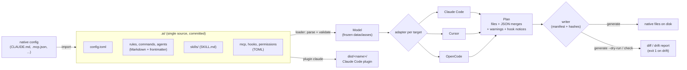
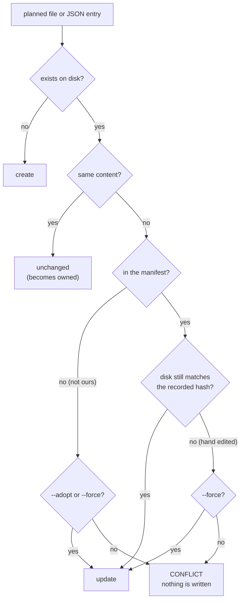

# pyaisync

One source (`.ai/`) for the AI coding agent configuration of a repository.
`pyaisync` transpiles it into the native files of **Claude Code**, **Cursor** and **OpenCode**.

## Installation

**Requirements:** Python 3.11 or newer and [`uv`](https://docs.astral.sh/uv/). `pyaisync` is not on PyPI yet, so it is
installed from GitHub. Its only runtime dependency is `PyYAML`.

### Add it to your project (recommended)

Install it as a **development dependency** of the Python project whose AI configuration you want to manage:

```bash
uv add --dev git+https://github.com/AbdielFco/pyaisync
uv run pyaisync --version
```

This records it in your `pyproject.toml` (`dependency-groups.dev` plus a `tool.uv.sources` entry) and **pins the exact
commit in `uv.lock`**, so everyone on the team and your CI get the same version after `uv sync`. Commit both files.
To pin a release instead of the latest commit, add a tag or commit: `uv add --dev git+https://github.com/AbdielFco/pyaisync --rev <tag-or-commit>`.
To update: `uv lock --upgrade-package pyaisync && uv sync`.

Then use it as `uv run pyaisync ...` (see the quick start below).

<details>
<summary>Other ways to install</summary>

- **Without installing anything:** `uvx --from git+https://github.com/AbdielFco/pyaisync pyaisync --help`
- **As a global command:** `uv tool install git+https://github.com/AbdielFco/pyaisync` (then run `pyaisync ...` directly;
  update with `uv tool upgrade pyaisync`, remove with `uv tool uninstall pyaisync`).
- **With pip / a requirements file:** `pip install git+https://github.com/AbdielFco/pyaisync.git`, or add
  `pyaisync @ git+https://github.com/AbdielFco/pyaisync.git` to `requirements-dev.txt`.
- **From a clone (to work on pyaisync itself):** `git clone https://github.com/AbdielFco/pyaisync.git && cd pyaisync && uv sync`.

</details>

### Quick start

```bash
cd your-repo
uv run pyaisync init                 # create .ai/ (use `init --from claude` to import an existing setup)
# edit .ai/rules/*.md, .ai/commands/*.md, ...
uv run pyaisync generate --dry-run   # preview
uv run pyaisync generate             # write CLAUDE.md, .cursor/, AGENTS.md, ...
uv run pyaisync check                # in CI: fails if generated files drifted from .ai/
```

Commit `.ai/` together with the generated files. Run `uv run pyaisync check` in CI or as a pre-commit hook so the
generated files cannot drift from the source.

Status: **complete (phases 0-4)**: rules, commands, skills, subagents, MCP, hooks, permissions, with
`init`, `generate`, `check`, `list`, `import` (every feature) and `plugin claude`.
See [PLAN.md](PLAN.md) for the design and [docs/formats](docs/formats/README.md) for the native formats it targets.

## How it works



What the writer does with each file it is about to write (any conflict aborts **before** anything is written):



Typical workflow: `init` (or `init --from <tool>` to migrate an existing setup) -> edit `.ai/` -> `generate` ->
commit both; `check` in CI or a pre-commit hook fails when the generated files drift from `.ai/`.

## Usage

The examples below use `uv run pyaisync`, which works when it is a dependency of your project. If you installed it
as a global command (`uv tool install`), drop the `uv run` prefix.

```bash
uv run pyaisync init                  # create .ai/ (detects existing targets)
uv run pyaisync init --from claude    # init + import CLAUDE.md, .claude/commands and skills
uv run pyaisync generate --dry-run    # preview what would change
uv run pyaisync generate              # write the native files
uv run pyaisync check                 # CI / pre-commit: fails on drift
uv run pyaisync list                  # support matrix
uv run pyaisync import cursor         # bring Cursor's native config into .ai/
uv run pyaisync plugin claude         # package .ai/ as a Claude Code plugin (dist/<name>)
```

From another project: `uvx --from /path/to/pyaisync pyaisync check`.

## What it generates

| Source `.ai/` | Claude Code | Cursor | OpenCode |
|---|---|---|---|
| `rules/*.md` | `CLAUDE.md` | `.cursor/rules/<n>.mdc` | `AGENTS.md` |
| `commands/*.md` | `.claude/commands/<n>.md` | `.cursor/commands/<n>.md` | `.opencode/commands/<n>.md` |
| `skills/<n>/` | `.claude/skills/<n>/` (all 3 read it) | ← same | ← same |
| `agents/*.md` | `.claude/agents/<n>.md` | `.cursor/agents/<n>.md` | `.opencode/agents/<n>.md` |
| `mcp.toml` | `.mcp.json` (`mcpServers`) | `.cursor/mcp.json` (`mcpServers`) | `opencode.json` (`mcp.servers`) |
| `hooks.toml` | `.claude/settings.json` (`hooks`) | `.cursor/hooks.json` | not supported (warning) |
| `permissions.toml` | `.claude/settings.json` (`permissions`) | `.cursor/cli.json` (CLI only, no `ask`) | `opencode.json` (`permissions`) |

If Claude is not among the targets, skills go to `.agents/skills/` (read by Cursor and OpenCode).

## Subagents and MCP

```markdown
<!-- .ai/agents/reviewer.md -->
---
description: Read-only code reviewer
tools: [read, grep, glob]      # read, grep, glob, edit, shell, web (omit = inherit all)
---
You are a strict reviewer. Do not modify files.
```

```toml
# .ai/mcp.toml
[servers.docs]
type = "http"                  # stdio | http | sse
url = "https://example.com/mcp"
headers = { Authorization = "Bearer ${DOCS_TOKEN}" }   # secrets only as ${VAR}
```

MCP entries are **merged** into `.mcp.json`, `.cursor/mcp.json` and `opencode.json`: your own entries
are kept, and only the ones pyaisync generated are updated or removed. Files with comments (JSONC)
are refused instead of rewritten. OpenCode support targets the **V2** config schema.

## Hooks and permissions

```toml
# .ai/hooks.toml  — hooks run COMMANDS on your machine; review them like code
[[hooks]]
event = "pre_tool_use"
matcher = ["shell"]                # read, grep, glob, edit, shell, web
command = "./scripts/guard.sh"     # one line, relative to the repository root

# .ai/permissions.toml
allow = ["shell(uv run pytest*)"]
ask   = ["shell(git push*)"]
deny  = ["read(.env*)", "shell(rm -rf*)"]
```

`generate` and `check` print every hook command that will run. Rules or hooks a target cannot express
(Cursor has no `ask`; OpenCode has no declarative hooks) are skipped **with a warning**, never approximated.
Your own entries in `.claude/settings.json`, `.cursor/hooks.json`, etc. are preserved.

## Import

`import <claude|cursor|opencode>` reads the native files and writes only to `.ai/`: rules, commands, skills,
**subagents, MCP servers, hooks and permissions**. It reports everything it cannot map, never widens access
(an allow rule or tool allowlist that cannot be mapped exactly is skipped) and **never copies a literal secret**:
sensitive values become `${VAR}` references and the warning tells you which variable to set. Entries pyaisync generated
itself are not re-imported. Conflicts: `--on-conflict skip|rename|overwrite`.

## Claude Code plugin

```toml
# .ai/config.toml
[plugin]
name = "my-tools"          # kebab-case; names starting with claude-/anthropic- are reserved
version = "1.0.0"
description = "Team tools"
```

`pyaisync plugin claude` writes `dist/my-tools/` (`.claude-plugin/plugin.json`, `commands/`, `agents/`, `skills/`,
`hooks/hooks.json`, `.mcp.json`). Rules and permissions cannot be part of a plugin and hook scripts are not bundled;
both are reported. Same non-destructive rules as `generate`.

## Scope and limitations

### In scope
- **Targets:** Claude Code, Cursor and OpenCode (V2 config schema), at **project level** only.
- **Features:** rules, commands, skills, subagents, MCP servers, hooks, permissions; `import` of all of them; a
  Claude Code plugin package.
- **Guarantees:** deterministic output, no network access, nothing from your content is ever executed, and files it did
  not generate are never overwritten.

### Not in scope
- More targets (Windsurf, Copilot, Gemini, ...). Adding one means writing an adapter and an importer.
- User-level/global configuration (`~/.claude`, `~/.cursor`, `~/.config/opencode`).
- Downloading rules or skills from remote repositories.
- Running agents, hooks or MCP servers, or two-way/continuous sync (`import` is a one-off migration).
- Cursor and OpenCode plugin packaging. OpenCode plugins are JS/TS code, not configuration; Cursor's plugin format
  was not verified. `plugin` exists for Claude Code only.

### Differences between targets
Features a target cannot express are skipped **with a warning**, never approximated:

| Feature | Limitation |
|---|---|
| Hooks | OpenCode has no declarative hooks (skipped). Cursor cannot match `glob`/`web` tools (that hook is skipped for Cursor). |
| Permissions | Cursor's apply to the **Cursor CLI only** (`.cursor/cli.json`) and have no `ask`. Claude cannot express path rules for `grep`/`glob`. |
| Subagents | Cursor has no tool allowlist: only `readonly` is derived from `tools`. A non-`inherit` `model` is passed through verbatim and warned about, because model names differ per tool. |
| MCP | OpenCode V2 offers only Streamable HTTP, so `sse` servers are skipped for it. |
| Rules | Claude and OpenCode read a single instructions file, so scoped rules (`globs`/`description`) become labelled sections instead of being conditionally applied. |
| Plugin | Cannot carry project rules (a `CLAUDE.md` in a plugin is not loaded) or permissions. Hook scripts are not bundled. |

### Known technical limits
- **JSONC is refused.** `opencode.json`, `.mcp.json`, `settings.json` and similar files that contain comments are not
  merged (that would destroy the comments). Remove the comments or manage those files by hand.
- **JSON formatting.** A shared JSON file is rewritten with 2-space indentation, only when one of its entries changes.
- **List items are matched by content.** If you edit by hand a hook or permission that pyaisync added, it stops being
  recognised as generated: it is treated as yours and the regenerated item is added next to it.
- **OpenCode V1** config (`mcp.<name>`, `permission`, `tools`) is neither generated nor imported.
- **Import is best effort and conservative.** It skips what it cannot map exactly (regex hook matchers, non-command
  hooks, `disallowedTools`, order-dependent OpenCode rules, WebSocket MCP servers) and reports it. It does not split a
  large `CLAUDE.md`/`AGENTS.md`: it becomes one always-on rule.
- **Formats move fast.** The native formats were checked against the official docs on 2026-11-25. The one entry not
  confirmed in the docs is Cursor's `.cursor/commands/*.md`; see `docs/formats/README.md` before relying on it.
- **Python 3.11+** is required (`tomllib`).

## Safety

- No network access; nothing from the content is ever executed.
- Never overwrites files it did not generate (manifest with hashes in `.ai/.manifest.json`).
- Rejects names containing `..`, absolute paths and symlinks.
- Rejects literal secrets in `mcp.toml` (sensitive-looking keys must use `${VAR}`).

Development: `uv run pytest`, `uv run ruff check .`, `uv run mypy`. Contributors and AI agents: see
[AGENTS.md](AGENTS.md) and [docs/ARCHITECTURE.md](docs/ARCHITECTURE.md).
